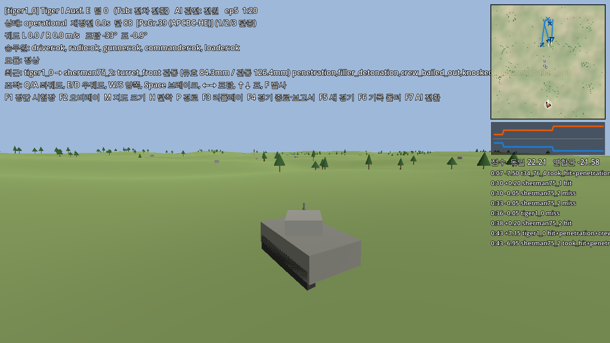
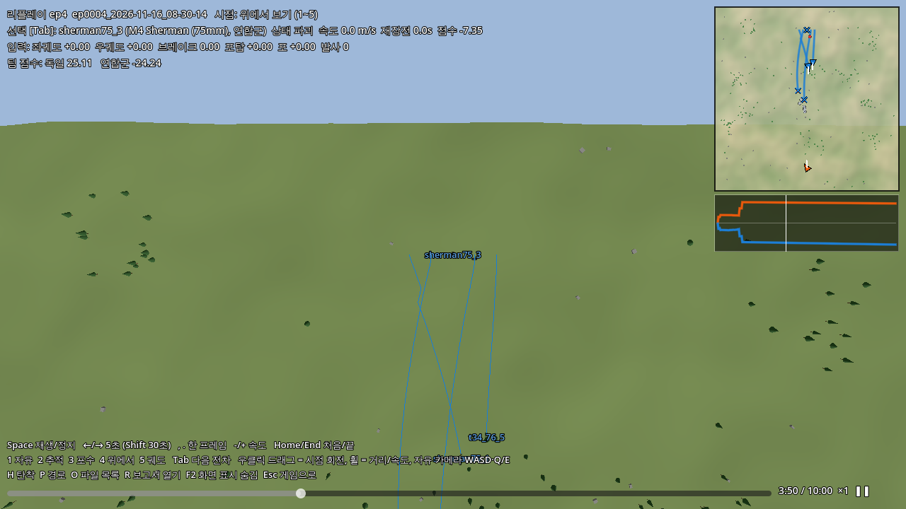
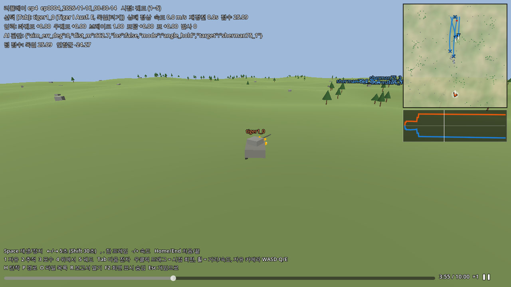
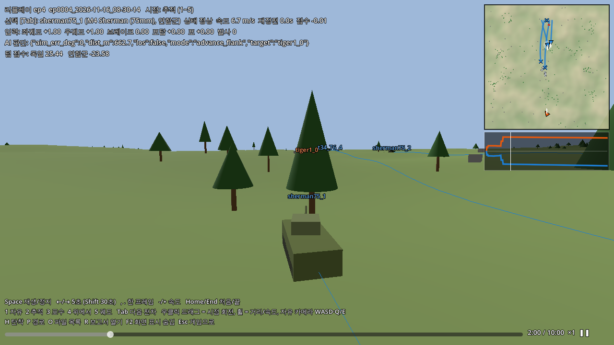
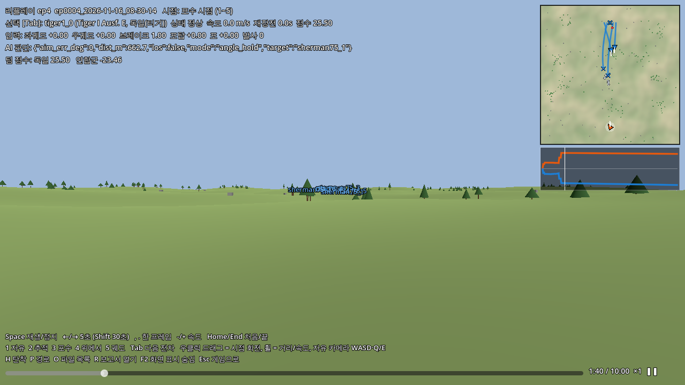
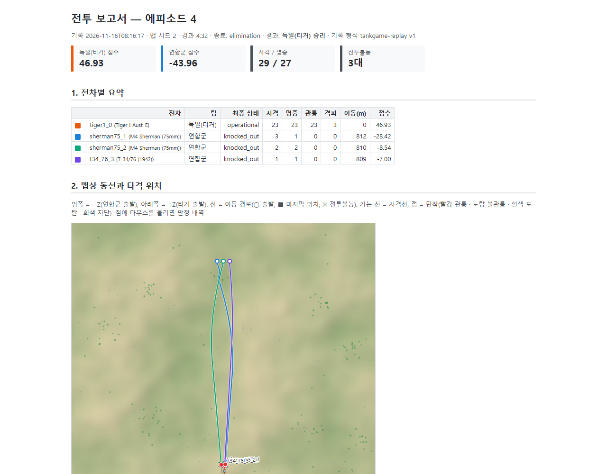

# Tank Game Machine Learning

2차 세계대전 전차전(티거 I vs 셔먼·T-34 다수)을 단순한 Godot 4 게임으로 만들고,
자기대전(self-play) 학습으로 당시 전술(티거의 비스듬한 대면, 연합군의 우회·측면 공격 등)이 나타나는지 확인하는 프로젝트.

- 엔진: Godot 4.3 이상 (GL Compatibility 렌더러, 에셋 없이 프리미티브 도형만 사용)
- 물리: 30 Hz. 헤드리스 실행 시 메시를 만들지 않아 학습용으로 가볍다.

## 실제 실행 화면

아래 이미지는 저장소에 보관된 **1280×720 실제 게임·리플레이 캡처**다.
프리미티브 도형으로 지형·전차·장애물을 표시하고, 전술과 기록을 확인하는 데 필요한 정보를 함께 보여 준다.
캡처는 이전 실행 버전의 화면이며, 현재 사람 조종 HUD·마우스 조준·탄착 창은 [사람 조종 안내](docs/HUMAN_CONTROLS.md)를 참고한다.
각 화면과 아래 HTML 보고서는 서로 다른 경기 자료이므로 화면의 점수·전차 수를 보고서 수치와 합산하지 않는다.

### 게임 중 관찰 오버레이



왼쪽 위에는 조종 전차, 팀, AI 모드, 경기 시간, 재장전, 탄종, 좌우 궤도 속도,
포탑·포 각도, 승무원·모듈 상태와 최근 피격 판정을 표시한다.
오른쪽에는 미니맵 위의 이동 경로·탄착, 팀별 누적 점수 그래프, 최근 보상 사건을 표시한다.
이 화면에서는 티거의 3인칭 시점과 전원 AI 관전 상태를 확인할 수 있다.
게임에서 `F2`로 오버레이, `M`으로 지도 크기, `H`로 탄착, `P`로 경로 표시를 바꾼다.

### 리플레이로 같은 기록을 여러 방향에서 확인

| 위에서 보기: 전차 배치와 이동 경로 | 궤도 시점: 선택 전차 주변 관찰 |
|---|---|
|  |  |
| 추적 시점: 선택 전차를 따라 이동 | 포수 시점: 포 방향에서 장면 확인 |
|  |  |

`F3`로 뷰어를 연다. `Space`는 재생·정지, `←/→`는 5초 이동(`Shift`와 함께 30초),
`Tab`은 선택 전차 변경이다. 화면 아래 시간 막대로 관심 시점으로 이동한다.
리플레이 HUD에는 기록된 입력과 AI 판단이 표시되어, 이동·사격 결과를 당시 행동과 연결해 살펴볼 수 있다.
리플레이 포수 시점 그림은 기록 재생 화면이며 현재 사람 조종용 조준경 UI와는 구성이 다르다.

## 실제 출력된 경기 보고서

원본 예시: [티거 승리 경기 HTML 보고서](docs/sample/sample_report_tiger_win.html).
GitHub에서는 HTML 소스가 표시되므로 저장소를 내려받은 뒤 이 파일을 브라우저로 연다.
보고서는 그림이 포함된 단일 HTML이며, 브라우저 인쇄 기능으로 PDF로 저장할 수 있다.



위 그림은 보관된 HTML을 브라우저에서 열어 1280×1000 크기로 캡처한 것이다.
[자료 출처와 캡처 정보](docs/sample/README.md)에서 원본과 화면의 관계를 확인할 수 있다.

### 예시 경기 결과와 해석

아래 수치는 HTML의 경기 머리말과 **전차별 요약 표**에서 확인한 값이다.
보고서의 기록 시각은 `2026-11-16T08:16:17`이며 시간대 표기는 없다.
이 예시는 **티거 1 vs 셔먼 2 + T-34 1**의 4대 경기다. 메인 게임의 기본 6대 편성과 구분한다.

| 항목 | 실제 보고서 값 |
|---|---|
| 에피소드 / 맵 시드 | 4 / 2 |
| 경기 시간 / 종료 사유 | 4분 32초 / `elimination` |
| 승리 팀 | 독일(티거) |
| 팀 점수 | 독일 46.93 / 연합군 −43.96 |
| 전체 사격 / 명중 | 29 / 27 (명중률 약 93.1%) |
| 전투불능 | 연합군 3대 |

| 전차 ID | 최종 상태 | 사격 | 명중 | 관통 | 격파 | 이동 거리(m) | 점수 |
|---|---|---:|---:|---:|---:|---:|---:|
| `tiger1_0` | operational | 23 | 23 | 23 | 3 | 0 | 46.93 |
| `sherman75_1` | knocked_out | 3 | 1 | 0 | 0 | 812 | −28.42 |
| `sherman75_2` | knocked_out | 2 | 2 | 0 | 0 | 810 | −8.54 |
| `t34_76_3` | knocked_out | 1 | 1 | 0 | 0 | 809 | −7.00 |

이 경기에서 티거는 이동 거리 0m인 상태로 23발을 모두 명중·관통시켰고,
연합군은 약 809~812m 이동했다. 티거 포탑 정면에 명중한 연합군의 4발은 모두 불관통이다.
단일 경기에서 나온 결과이므로 전차별 일반 승률이나 학습 정책의 성능으로 해석하지 않는다.
보고서만으로 사용한 학습 체크포인트를 확인할 수 없으므로 자기대전 학습 성과로 집계하지 않는다.

사격별 분석 예시:

| 시각 | 공격 → 표적 | 거리 | 부위 / 입사각 | 유효장갑 / 관통력 | 결과 |
|---|---|---:|---|---|---|
| 1:39 | T-34 → 티거 | 88m | `turret_front` / 2° | 120 / 77mm | 불관통 |
| 1:39 | 티거 → T-34 | 85m | `turret_front` / 33° | 59 / 144mm | 관통, 승무원 이탈로 전투불능 |
| 2:04 | 티거 → 셔먼 2 | 90m | `turret_front` / 32° | 86 / 142mm | 관통, 승무원·포탑 회전부 피해 |

관통과 격파는 별도 지표다. 예를 들어 셔먼 1에는 여러 차례 관통이 발생한 뒤 4:32에
승무원 이탈로 전투불능이 기록된다. 명중 수뿐 아니라 피해 사건과 종료 상태를 함께 확인해야 한다.

**자료 해석 시 주의:** 이 HTML의 5번 누적 그래프에는 “5개 에피소드, 무승부 5”가 표시되어
현재 경기 머리말의 티거 승리와 일치하지 않는다. 누적 그래프를 이 경기의 승패 통계로 사용하지 않는다.
전차별 표와 그래프의 점수도 반올림으로 0.01 차이가 있다. 위 표는 전차별 요약 값을 그대로 옮겼다.

### 보고서에서 확인할 수 있는 항목

| 보고서 영역 | 확인하는 내용 |
|---|---|
| 전차별 요약 | 최종 상태, 사격·명중·관통·격파, 이동 거리, 점수 |
| 맵상 동선·타격 위치 | 접근 경로, 사격선, 탄착과 가림 여부. 탄착점에 마우스를 올리면 판정 표시 |
| 팀별 체류 히트맵 | 각 팀이 오래 머문 구역과 진격·대기 위치 |
| 팀·전차 누적 점수 | 점수가 변한 시점과 전투불능 시각 |
| 에피소드별 점수 곡선 | 별도로 누적된 `episodes.csv`의 경기 추이 |
| 피탄 분석 | 부위별 관통률과 입사각 분포 |
| 전체 타격 기록 | 거리, 탄종, 부위, 유효장갑, 관통력, 관통확률, 피해 사건과 점수 |
| 보상 가중치 | 해당 기록에서 사용한 점수 규칙 |

### 직접 경기 기록과 보고서 만들기

게임 중 `F4`를 누르면 경기를 종료하고 보고서를 만든다. `F6`으로 기록 폴더를 연다.
규칙 AI 경기 여러 판을 화면 없이 기록하려면 저장소 루트에서 실행한다.

```powershell
godot --headless --fixed-fps 30 --path . -- --episodes=10 --seed=2 --time-limit=600
```

`godot`은 설치한 Godot 실행 파일 경로로 바꿀 수 있다. 이 명령은 학습된 PPO 정책의 평가 명령이 아니라
게임의 AI 경기 기록 명령이다. 기록기·보고서 구조는 [recording/README.md](recording/README.md)에 설명되어 있다.

| 출력 | 용도 |
|---|---|
| `user://logs/replays/ep####_<시각>/events.jsonl` | 프레임 상태, 사격, 보상, 판단, 경기 종료 기록 |
| 같은 폴더의 `report.html` | 브라우저에서 읽는 경기 보고서 |
| 같은 폴더의 CSV 파일 | 사격·동선·점수를 표 계산 프로그램에서 분석 |
| `user://logs/episodes.csv` | 여러 경기의 요약 누적 |

Windows의 기본 기록 위치는 `%APPDATA%/Godot/app_userdata/Tank Game Machine Learning/logs/`다.
보고서와 CSV를 함께 보관하면 화면에서 본 사건을 수치와 비교할 수 있다.
리플레이는 기록된 상태를 보간해 재생하며, 저장된 행동으로 시뮬레이션을 다시 수행하는 학습 에피소드 재현과는 방식이 다르다.

## 학습 결과를 확인하는 방법

프로젝트에는 PPO·커리큘럼·상대 정책 풀·대시보드·HTML 학습 보고서 기능이 구현되어 있다.
목표는 티거 1 vs 셔먼 3 + T-34 2 자기대전이지만, 위 예시 경기만으로 목표 전술의 학습 완료를 주장할 수 없다.
지형주행 v3의 13개 코스도 제어기 완주·재현 검증과 학습 정책의 습득 여부를 구분한다.

`training/python/dashboard.bat`로 대시보드를 열어 실행별 단계, 성공률, 보상, 처리량,
체크포인트와 최근 에피소드를 확인한다. 기본 학습 저장 위치는
`%LOCALAPPDATA%/TankGameML/training/runs`이며 `TANKGAME_DATA_DIR`로 바꿀 수 있다.

실제 실행의 HTML 학습 보고서는 다음과 같이 생성한다(저장소 루트 기준).

```powershell
python training/python/report.py "$env:LOCALAPPDATA/TankGameML/training/runs/<run>"
```

`<run>`을 실제 실행 이름으로 바꾼다. 해당 실행 폴더에 `training_report.html`이 생성된다.
경기 보고서는 한 판의 전투를, 학습 보고서는 여러 에피소드에 걸친 정책 훈련을 설명한다.

| 학습 자료 | 확인할 내용 |
|---|---|
| `run.json` | 실행 설정, 버전, 단계 정의와 실행 환경 |
| `progress.csv` | 에피소드별 성공·보상·길이·사격 통계·시드·재현 경로 |
| `curriculum_log.jsonl` | 단계 변경 시점과 당시 평가 |
| `training_report.html` | 단계별 곡선·통계·승급 기록과 경기 링크 |
| `episodes/env*/<uid>.json` | 설정·시드·저장 행동으로 에피소드 재현 |
| `<tank>/checkpoints/`, `checkpoint.json` | 모델·커리큘럼·체크섬을 묶은 저장 세대와 재개 기준 |

자세한 사용법은 [강화학습 안내](training/README.md), 현재 주행 과제는
[지형주행 v3](training/TERRAIN_V3.md), 저장·복구 규칙은 [로컬 학습 안내](training/LOCAL_TRAINING.md)를 참고한다.
과거 환경의 모델과 기록은 [보존 스냅샷](training/snapshots/README.md)에서 확인할 수 있다.

## 폴더 구성

| 폴더 | 내용 |
|---|---|
| `tanks/` | 전차별 고유 모델(형상·경사장갑, 기동, 사격 특성), 공통 모듈(궤도·포탑·포방패·주퇴기/주포·장갑), 피해 모델, 전차 노드 → [tanks/README.md](tanks/README.md) |
| `controls/` | 공용 조작 입력(`TankControlInput`, 액션 6개), 키보드, 시점(`TankView`)·관측(`TankPerception`)·소리(`SoundField`)·탑승자 묶음(`TankAgent`) → [controls/OBSERVATION.md](controls/OBSERVATION.md) |
| `map/` | 전술 지형 생성기(`HillMap`, 시드로 재현), 시야·탐지 판정(`LineOfSight`), 거리 격자(`RangeGrid`) → 아래 "맵과 시야" |
| `tanks/lab/` | 장갑 시험장(시각화 + 관통 시험) |
| `recording/` | 경기 기록·점수(보상)·보고서·리플레이 뷰어·관찰 오버레이·규칙 AI → [recording/README.md](recording/README.md) |
| `training/` | 강화학습: 헤드리스 학습 환경(`training_env.tscn`), 단계별 보상, Python PPO·커리큘럼·자기대전·학습 보고서·지난 판 재현 → [training/README.md](training/README.md) |
| `training/snapshots/` | 환경 변경 전 모델·학습 데이터·경기 기록 보존본. 다운로드는 `git lfs pull` → [복원·검증 안내](training/snapshots/README.md) |
| `build/` | Windows 실행 파일 출력 위치 |
| `main.tscn` / `main.gd` | 메인 씬: 티거 1 vs 셔먼 3 + T-34 2, 경기 기록·보고서 자동 생성 |

## 조작 (모든 전차 공통)

| 키 | 동작 | 액션 벡터 |
|---|---|---|
| Q / A | 왼쪽 궤도 전진 / 후진 | [0] left_track −1~1 |
| E / D | 오른쪽 궤도 전진 / 후진 | [1] right_track −1~1 |
| W / S | 양쪽 궤도 함께 | (0, 1 에 합산) |
| Space | 브레이크 | [2] brake 0~1 |
| 마우스 / R | 커서 지점으로 포탑·포 조준 / 마우스 조준 켜기·끄기 | 사람 입력을 기존 조작 벡터로 변환 |
| ← / → | 포탑 선회 | [3] turret_traverse −1~1 (+ = 우) |
| ↑ / ↓ | 포 고저 | [4] gun_elevation −1~1 |
| 좌클릭 / F / Enter | 발사 | [5] fire (>0.5) |
| 1 / 2 / 3 | 탄종 선택(철갑 / 고속철갑·고체철갑 / 고폭) | (`tank.select_ammo(i)`) |
| Shift | 포수 조준경 시점 켜기/끄기: 포구에서 포 방향을 보고, 거리별 조준 눈금(현재 탄종 탄도)·조준 오차 원 표시. 휠/+− 로 저·고배율(약 3배/6배) | - |
| C / 우클릭 (누르는 동안) | 3인칭 자유 시선: 포탑·포를 고정하고 카메라만 돌림. 마우스 조준에서는 놓은 시야를 유지 | 포탑·포 입력 0 |
| B | 전차장 시점 켜기/끄기: 해치 높이에서 마우스/방향키로 둘러봄, 포는 고정. 휠/+− 로 확대(최대 약 9배) | 포탑·포 입력 0 |
| Tab | 조종 전차 전환 | - |
| G | 거리 표시 순환: 격자+거리 링 → 끔 → 격자 → 링만 | - |
| V | 시선 표시(초록 탐지 / 노랑 일부 보임 / 빨강 가려짐) | - |
| F1 | 장갑 시험장 열기 | - |
| F2 / M | 관찰 오버레이(미니맵 동선·탄착·점수 그래프) 켜기·끄기 / 지도 크게 | - |
| H / P | 3D 탄착 표시 / 이동 경로 선 켜기·끄기 | - |
| F3 | 리플레이 뷰어(지난 경기 다시 보기) | - |
| F4 | 경기 종료 + 보고서 생성 | - |
| F5 | 새 경기 | - |
| F6 | 기록 폴더 열기 | - |
| F7 | AI 전환: 꺼짐 → 다른 전차 AI → 전원 AI(관전, 카메라 = 그 전차 AI 가 고른 시점) | - |
| F8 | 상세 HUD 켜기·끄기 | - |
| K | 공정 시야 켜기/끄기(기본 켬): 사람에게도 AI 와 같은 정보만(미탐지 적 숨김, 거리 숨김) | - |

AI 는 `TankAgent.apply_action([...11개])` 로 조작 6개 + 시점 5개를 넣는다(사람의 키보드·Shift/B/C/휠과 같은 효과).

사람 조종에서는 움직이는 좌우 트레드·바퀴와 손상 색상을 표시한다.
미니맵 아래 탄착 창은 포탄 진행 방향에서 명중 위치로 접근한 뒤 피격 부위를 확대한다.
조준 방식과 표시의 자세한 설명: [사람 조종 안내](docs/HUMAN_CONTROLS.md).

**AI 관측 = 사람이 그 시점에서 보고 듣는 것.** 시점 상태(`controls/tank_view.gd`)는 그래픽 없이도 동작해서
헤드리스 학습에서 AI 가 3인칭/포수/전차장 시점을 골라 쓰고, 관측(`controls/perception.gd`)은 그 시점 화면 안에서
탐지된 전차만, 정확한 거리 대신 화면 크기(px)로 준다. 소리(포성·탄착·피탄·엔진)도 방향·크기로 들어간다.
규칙 AI 도 이 관측만 쓴다. 자세한 규격: [controls/OBSERVATION.md](controls/OBSERVATION.md)
C·B 로 시선이 포와 분리된 동안은 방향키가 카메라를 돌리고 포탑·포 입력이 0 으로 기록된다(포가 움직이지 않음).
자유 시선·전차장 시점에서는 왼쪽 아래 방위판(차체 사각형, 노란 선 = 포, 하늘색 = 시야)과 ◇포 표시로 포가 어디를 겨누는지 보여 준다.

같은 입력이라도 전차마다 결과가 다르다: 실제 기어표의 변속기로 서서히 가속하고(T-34 2→3단 3초 동력 단절, 전후진 전환 3초),
차체가 지형 굴곡·돌·통나무를 따라 피치/롤로 기울고 출렁이기 때문에 포 각도를 다시 맞춰야 하며,
포 내림각(T-34 −5°, 티거 −8°, 셔먼 −10°)이 헐다운 가능 여부를 정한다.
움직이며 쏘면 조준 오차가 커지는데 셔먼은 안정장치 덕에 그 폭이 작다. 자세한 내용은 [tanks/README.md](tanks/README.md).

## 실행 파일

`build/TankGame.exe` 를 더블클릭하면 바로 실행된다(Godot 설치 불필요, 데이터 내장).
다시 빌드하려면 Godot 에디터에서 프로젝트 → 내보내기 → "Windows Desktop", 또는
`godot --headless --path . --export-release "Windows Desktop" build/TankGame.exe`
(Godot 4.3 Windows 내보내기 템플릿 필요).

## 장갑 시험장 (F1, 또는 `tanks/lab/armor_lab.tscn`)

- 표적 전차의 장갑 구역을 색으로 표시: **두께 / 현재 시점 기준 유효장갑 / 선택 탄종·거리의 관통확률**
- 탄종 9종(전차별 3종)과 거리(50~2500m), 표적 차체·포탑 회전, 시점 프리셋(정면·티타임 35°·측면·후면)
- 좌클릭 = 그 지점에 사격(카메라 방향이 사격 방향). 결과: 구역, 입사각, 유효장갑, 관통력 굴림값, 피해 내역, 승무원·모듈 상태
- "현재 시점 200발": 실루엣 전체에 무작위로 쏴서 구역별 관통률·한 발 전투불능률과 탄착 분포 표시
- 내부 보기: 승무원(파랑/노랑 부상/검정 전사)과 모듈(주황/빨강 손상/회색 파괴) 배치
- 아래 그래프: 그 포의 탄종별 거리-관통력 곡선 + 마우스가 가리키는 구역의 유효장갑선

## 실행

```
godot --path .                                                     # 게임 실행(키보드 조작)
godot --headless --path . -s res://tanks/tests/run_tank_tests.gd   # 장갑·피해·모듈 검증
godot --headless --path . -s res://tanks/tests/run_trait_tests.gd  # 전차별 특성(기동·헐다운·안정장치·조준·탄도)
godot --headless --path . -s res://controls/tests/run_sim_smoke.gd # 주행·선회·사격 통합 테스트
godot --headless --path . -s res://controls/tests/run_view_tests.gd # 포수·전차장·자유 시선 시점, 포 고정
godot --headless --path . -s res://controls/tests/run_perception_tests.gd # 시점 기반 관측·소리·규칙 AI(보이는 것만)
godot --headless --path . -s res://map/tests/run_map_tests.gd      # 맵 재현성·차단물별 시야 판정·시선 통계
godot --headless --fixed-fps 30 --path . -s res://recording/tests/run_record_tests.gd  # 기록·리플레이·보고서 검증
godot --headless --fixed-fps 30 --path . -- --episodes=10           # AI 끼리 10판 연속(빠르게) 기록
godot --path . -- --spawn-distance=500                               # 양 팀 출발 거리 500m(기본 900m)
python training/python/train.py --godot <godot> --project . --tank tiger1   # 강화학습(커리큘럼) → training/README.md
```

경기 기록·보고서: `user://logs/replays/ep####_<시각>/` (events.jsonl, report.html, CSV),
에피소드 요약: `user://logs/episodes.csv`
(Windows: `%APPDATA%\Godot\app_userdata\Tank Game Machine Learning\logs\`, 게임에서 F6)

## 맵과 시야

`HillMap` (map/hill_map.gd) 은 `map_seed` 하나로 같은 지형을 다시 만든다. 경기 기록에는 지형 격자와 모든 배치가 통째로 저장되어(`to_record`/`load_record`) 생성기가 바뀌어도 지난 경기를 재구성할 수 있다. 1200m 정사각형, 스폰은 Z ±450.

| 요소 | 포탄 | 시야 | 전술적 의미 |
|---|---|---|---|
| 능선 3개 (진격축을 가로지름, 안부 통로 1~2곳) | 차단 | 차단 | 반사면에 차체를 숨기는 hull-down, 능선 넘을 때 노출 |
| 숲 8곳 (절반은 양 측면) | 줄기만 | 25m 통과 시 10% | 은폐·매복, 측면 우회로 차폐 |
| 수목선 (능선 마루) | 줄기만 | 감쇠 | 마루 위 은폐 사격 진지 |
| 생울타리 (흙둑 1.2m + 덤불 3.5m, 틈 있음) | 흙둑 | 거의 차단 | 보카주식 근접 매복 |
| 돌담 1.4m | 차단 | 차체만 가림 | 포탑만 내미는 hull-down |
| 마을(교차로) + 외딴 농가 | 차단 | 차단 | 시가지 엄폐 |
| 바위 무더기, 외딴 나무 | 차단 / 수관 감쇠 | | 소규모 엄폐 |

**시야 판정** (`LineOfSight`, AI 와 HUD 가 같은 함수 사용):
관측자 전차장 눈높이 → 표적의 표본점 6곳(포탑 위·중앙, 차체 앞·뒤·좌·우)으로 시선을 긋고,
지형·건물·바위·흙둑·돌담·나무줄기·다른 전차(레이어 1·2)는 물리 레이캐스트로 완전 차단,
숲·덤불·수관(레이어 4)은 통과 거리로 투과율 `exp(-밀도×거리)` 를 구한다.
`visible_fraction` = 표본점 투과율 평균. 탐지 = `visible_fraction ≥ 0.12` 이고
`거리 ≤ 1400m × 표적 크기 × 이동(최대 1.5배) × 관측자(T-34 전차장 포수 겸임 0.8) × visible_fraction`.

```gdscript
var seen := LineOfSight.spotted_enemies(map, my_tank, tanks)  # [{target, detected, visible_fraction, distance, blocked_by, ...}]
var r := LineOfSight.ray(map, from, to)                        # 임의 두 점 사이 {transmittance, blocked_by}
map.cover_at(pos)                                              # 그 지점을 덮는 잎 볼륨 종류(숲 속인가 등)
```

시드 1 맵 통계(임의 두 지점 200~900m, 눈높이 2.7m → 1.5m): 시선 트임 평지 100% → 지형만 25% → 전체 약 10% (+부분 가림 7%).
시선 1회 약 36µs (전차 6대 전원 상호 판정 ≈ 6.5ms).

거리 표시(`RangeGrid`, 화면 전용): 100m 격자(500m 마다 노란 굵은 선) + 중심선 좌표 라벨, 조종 전차 주위 100m~1km 거리 링(포탑 방향에 거리 라벨), 지면 50m 체커 무늬.

## 충돌 레이어

1 = 지형·바위·나무줄기·건물·흙둑·돌담(포탄·시야 차단), 2 = 전차, 4 = 숲·덤불·수관(시야만 차단, 포탄 통과)

## 학습과 기록 보존

지형주행은 짧은 직진부터 회전·경사·턱·나무 우회·바위·통로·숲길·복합 주행까지
13개 시험공간을 순서대로 연습한다. [지형주행 v3 안내](training/TERRAIN_V3.md)를 참고한다.
모델·체크포인트·학습 기록은 프로그램 폴더와 분리된 `%LOCALAPPDATA%/TankGameML/training/runs`에 저장한다.
기존 정책은 자동으로 이어받으며, [로컬 학습과 복구 안내](training/LOCAL_TRAINING.md)에 현재 실행과 저장 규칙을 기록했다.

## 앞으로 확인할 과제

- 지형주행 13개 코스의 학습 정책 성공률과 미학습 시드 일반화 평가.
- 사격·수색·1대1·팀 자기대전 단계의 반복 평가와 정책별 성능 비교.
- 티거의 비스듬한 대면, 연합군의 측면 우회가 나타나는지 리플레이·피탄 통계로 검증.
- 평가 시 코드 버전·체크포인트·시드·보상 규칙을 함께 남겨 결과를 비교.
