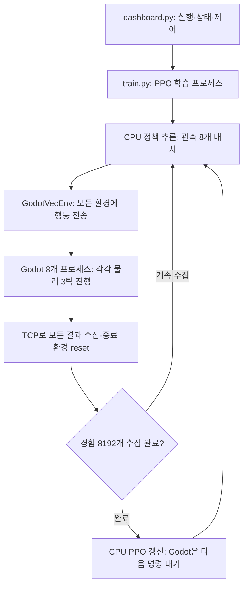

# 학습 구조 점검 및 CPU·GPU 활용 개선 계획

점검일: 2026-11-17, 한국 시간. 대상 실행: `20261117_063521`.

## 판단 요약

GPU 미사용 원인은 확인됐다. 현재 학습용 Python에는 `torch 2.15.0+cpu`가 설치되어 있고, 학습 장치는 `cpu`다. 같은 Python에서 `torch.version.cuda=None`, `torch.cuda.is_available()=False`를 확인했다.

CPU 병목의 위치와 비중은 아직 확정하지 않았다. Godot 8개는 이미 별도 프로세스로 병렬 실행된다. 다만 매 결정마다 모든 환경 결과를 기다리는 구조, Godot의 반복 확인 방식 통신 대기, 수집과 PPO 갱신의 교대 실행이 처리량을 제한할 수 있다. 먼저 구간별 시간을 측정하고, 통신 대기와 스레드 구성을 개선한 뒤 CPU와 CUDA를 비교하는 순서가 적절하다.

목표는 같은 학습 품질에서 초당 처리 경험 수와 목표 성능 도달 시간을 개선하는 것이다. CPU·GPU 사용률 자체를 목표로 모델이나 학습량을 키우지는 않는다.

## 확인한 실행 상태

| 항목 | 확인 결과 |
|---|---|
| CPU | Intel Core i5-12400F, 물리 6코어 / 논리 12프로세서 |
| GPU | NVIDIA GeForce RTX 4070 SUPER, 약 12GB VRAM |
| 메모리 | OS에서 확인한 총 물리 메모리 약 31.8GiB |
| 학습 Python | 전역 Python 3.14.0, `Python314/python.exe` |
| 패키지 | PyTorch 2.15.0+cpu / Stable-Baselines3 2.9.2 / NumPy 2.4.2 / Gymnasium 1.4.0 |
| 환경 | `build/TankGame.exe`, Godot 4.3, headless 8개 |
| 정책 | PPO / MlpPolicy, actor·critic 은닉층 각각 `[256, 256]`, gSDE 사용 |
| 입출력 | 숫자 관측 389개 / 행동 11개. 이미지 입력이 아님 |
| 시뮬레이션 | 물리 30Hz, 행동 유지 3틱, 게임 시간 0.1초마다 정책 결정 |
| PPO 수집 | 환경당 1,024개 × 8개 환경 = 8,192개 경험 |
| PPO 갱신 | batch 2,048 / 8 epochs = 수집 1회당 optimizer step 32회 |
| 학습 스레드 | 실행 코드상 자동 계산 `12 - 8 = 4`개. 실행 중 프로세스 내부 값은 별도 조회하지 않음 |
| 인위적 배속 제한 | `speed_cap=0`, 무제한 |
| 기록 | 전체 리플레이는 200에피소드마다, 경량 재현 JSON은 모든 에피소드 |
| 속도 기록 | SB3 로그 16행 기준 누적 512~554 decisions/s, 마지막 512 |
| 커리큘럼 | `drive` 단계, 종료 전 완료 224에피소드 / 성공 1회 |

512 decisions/s는 8개 환경을 합한 수치다. 게임 시간으로 합계 약 51.2배속, 환경당 평균 약 6.4배속에 해당한다. SB3의 `fps`는 화면 프레임 수가 아니다.

최초 확인 시 학습 PID 22316과 자식 Godot 8개가 실행 중이었다. 이후 외부에서 `control.jsonl`에 `stop` 명령이 기록되어 **06:49:28 KST에 135,952스텝을 저장하고 정상 종료**했다. 점검 과정에서는 제어 명령을 보내지 않았다. CPU 시간 차이를 측정한 30초 구간은 이미 종료 후였으므로, 그 결과를 학습 CPU 사용률 근거로 사용하지 않는다. 학습 재실행·패키지 설치·학습 코드 수정은 수행하지 않았다.

관측 당시 시스템 전체 GPU 사용률은 0~6%였지만 다른 앱도 실행 중이었다. 이를 학습 CUDA 사용률로 해석할 수는 없다. CPU 전용 PyTorch 설치와 실제 장치 설정이 GPU 미사용의 직접 근거다.

## 현재 구조

실행 경로와 책임:

| 파일 | 역할과 근거 위치 |
|---|---|
| `training/python/dashboard.py` | 학습 Python 선택 290행, 의존성 검사 298행, 설치 326행, 명령 구성 357행, 재시작 427행 |
| `training/python/train.py` | 장치 기본값 58행, PPO 로드·생성 125행, 수집·갱신 상태 158행, 스레드 설정 240행 |
| `training/python/tankrl/godot_env.py` | Godot 실행, TCP 연결, 정책 행동 분배, 전 환경 결과 수집, 자동 reset |
| `training/python/tankrl/protocol.py` | 작은 JSON 헤더와 float32 바이너리로 통신. TCP_NODELAY는 연결 코드에서 이미 설정 |
| `training/training_env.gd` | 통신 수신 135행, 관측 전송 212행, reset 238행, 물리·의사결정 439행, 파일 저장 628행 |
| `controls/tank_agent.gd` | 관측을 3틱마다 갱신 |
| `controls/perception.gd` | 시야·접촉·소리 특징, 화면 격자 스캔 251행 |
| `training/python/tankrl/opponents.py` | 자기대전 상대 정책 로드·캐시·개별 추론 |

현재 실행은 내보낸 EXE를 사용한다. GDScript 변경을 반영하려면 별도 EXE로 다시 내보내고 실제 그 바이너리로 성능을 확인해야 한다. 원본과 내보낸 스크립트가 완전히 동일한지는 이번 점검에서 대조하지 않았다.

## 원인 및 병목 후보

### 1. GPU를 사용하지 않는 실행 환경 — 확인됨

`train.py:58`의 기본 장치는 `cpu`이고, 실행 manifest와 체크포인트에서도 CPU 학습 구성을 확인했다. 현재 CPU 전용 torch에서는 `--device cuda`만 추가해도 CUDA 학습이 가능해지지 않는다.

대시보드의 의존성 검사는 패키지 존재 여부만 확인한다. CUDA 사용 가능 여부·torch CUDA 빌드·실제 정책 장치를 검사하지 않는다. 기본 실행 폼에도 장치 선택 항목이 없으며, 추가 인자로 전달해야 한다. 재시작 로직도 `device`와 원래 추가 인자를 보존하지 않아, 추후 CUDA를 지정해도 환경 수 변경 재시작 시 CPU 기본값으로 돌아갈 수 있다.

다만 이 정책은 작은 숫자 입력 MLP다. SB3 공식 문서도 CNN을 사용하지 않는 PPO에는 CPU 실행을 우선 권한다. CUDA가 연결되더라도 작은 추론 배치와 CPU↔GPU 전송 때문에 전체 학습이 빨라질지는 실측해야 한다.

### 2. 모든 환경 결과를 기다리는 수집 — 구조 확인, 성능 영향 미측정

`GodotVecEnv.step_wait()`는 모든 Godot에 먼저 행동을 전송한다. 시뮬레이션 자체가 순차 실행되는 코드는 아니다. 이후 고정 순서로 응답을 받고, 모든 응답을 받은 뒤 종료된 환경을 reset한다.

한 환경의 지형 생성·기록 저장·무거운 관측이 오래 걸리면 다음 전체 행동 배치가 지연된다. 또한 기본 PPO는 수집을 끝낸 다음 갱신하므로, 갱신 중 Godot이 기다리는 것은 현재 알고리즘 실행 방식의 일부다. 비동기 수집은 큰 구조 변경으로 분리해야 한다.

### 3. Godot 통신 수신의 반복 확인 — 우선 검증 후보

`training_env.gd:135`는 수신 데이터가 없으면 poll과 짧은 delay를 반복한다. `20µs → 200µs → 15ms`로 대기 간격을 늘리는 형태다. Windows에서 짧은 delay의 실제 동작과 스케줄링 비용을 확인할 필요가 있다. 이 반복은 환경마다 존재한다.

Godot 4.3의 `StreamPeer.get_data()`는 필요한 바이트가 도착할 때까지 기다리는 API다. 먼저 이 방식 또는 통신 전용 수신기의 이벤트 대기 방식을 비교한다. 변경 시 연결 종료·부분 메시지·종료 요청 응답도 함께 확인한다. 대기 CPU 시간이 줄더라도 처리량이 유지되면 개선이다.

### 4. 환경 수와 PyTorch 스레드의 자동 배분 — 구성 확인, 최적값 미측정

현재 자동식은 논리 프로세서 수에서 환경 수를 뺀다. 물리 6코어에서 Godot 8개와 PyTorch 스레드 4개가 항상 효율적으로 공존한다고 보장하지 않는다. 특히 정책 추론 중 다른 환경의 통신 대기가 코어를 소비하면 경쟁이 발생할 수 있다.

환경 수를 무조건 늘리기 전에 4·6·8개와 torch 스레드 1·2·4개를 비교한다. 12개 환경은 앞선 결과가 계속 확장될 때만 추가한다.

### 5. 관측·기록·자기대전 비용 — 단계별 측정 필요

- 격자 관측은 45개 광선과 열별 수풀 판정을 수행한다. 이미 스캔 캐시와 갱신 간격 최적화가 들어 있다. 실제 프로파일에서 큰 비중일 때 충돌·수풀 공간 검색과 메모리 할당을 개선한다.
- 재현 JSON은 모든 에피소드 종료 시 응답 전에 동기 저장한다. 전체 리플레이 간격을 0으로 바꿔도 경량 JSON 저장은 남는다. 비용을 별도로 계측하고, 필요하면 결과를 복사해 저장 작업을 큐로 넘긴다.
- 맵은 동일 설정이면 재사용하고, Python도 기본 20에피소드 동안 같은 맵 시드를 사용한다. 맵 캐시가 전혀 없는 구조는 아니다.
- 자기대전에서는 상대 정책을 전차별로 호출하고, 호출마다 체크포인트 파일 상태를 확인한다. 현재 주행 단계의 주원인으로 볼 수는 없지만, 팀전에서는 동일 정책별 추론을 모아 배치 처리할 필요가 있다.

이미 headless에서 전차·맵 시각 생성이 비활성화된다. 렌더링 제거를 첫 개선 항목으로 삼을 근거는 없다. 또한 `--fixed-fps 30`은 고정 시뮬레이션 시간 간격을 위한 설정이며, 공식 문서상 실시간 동기화를 해제한다. 이를 초당 처리량 30 제한으로 해석해 제거하거나 물리 Hz·REPEAT를 바꾸면 학습 의미와 재현성이 달라진다.

## 실행 계획

### 1단계: 구간별 계측과 설정 신뢰성 확보

변경 대상: `train.py`, `tankrl/godot_env.py`, `tankrl/control.py`, `training_env.gd`, `dashboard.py`, `dashboard.html`.

1. 정책 추론, 행동 전송, 응답 대기, 응답 해석, reset, Godot 물리·관측 계산, 기록 저장, PPO 갱신 시간을 분리한다. 평균과 p50·p95, 환경별 분포를 기록한다.
2. 환경에서 보고하는 자체 연산 시간과 Python의 수신 대기 시간을 함께 남겨, 대기를 시뮬레이션 연산 시간으로 오인하지 않게 한다. 계측은 묶어서 출력하고 구간마다 파일을 쓰지 않는다.
3. 전체 CPU·학습 Python·각 Godot의 CPU 시간, 실제 코어 수, torch 스레드 수, 실제 정책 장치, CUDA 사용 가능 여부, GPU 전력·사용률·VRAM을 표시한다.
4. CLI와 대시보드에 장치·n_steps·batch_size·n_epochs·torch 스레드 설정을 명시적으로 연결하고, 재시작에서도 유지한다.
5. `PPO.load()` 경로의 실제 설정을 manifest에 남긴다. 현재는 새 모델 생성에만 `args.n_steps` 등이 적용되므로, 재개 실행에서 인자만 바꿔도 실험 조건이 바뀐다고 가정하면 안 된다. 재개 시에는 허용한 설정을 로드 시 명시적으로 전달하고, rollout buffer 크기까지 확인한다.

완료 기준: 전체 시간의 대부분을 어느 구간에서 사용하는지 설명할 수 있고, 요청한 설정과 실제 모델 설정이 일치한다. 계측 자체의 처리량 영향도 측정한다.

### 2단계: CPU 수집 경로와 대기 개선

1. Godot 수신 루프를 OS에 CPU를 양보하는 대기 방식과 비교한다. 물리 진행·행동 결정 순서는 유지한다.
2. 준비된 응답을 먼저 처리하고 reset을 겹칠 여지가 있는지 측정한다. 동기 PPO의 전체 환경 대기 자체가 사라지는 것은 아니다. 커리큘럼 보고와 난수 사용 순서는 명시적으로 관리한다.
3. 환경 4·6·8개와 torch 스레드 1·2·4개를 비교해 처리량·지연·CPU 시간을 기준으로 채택한다. 12개는 추가 후보로 둔다.
4. 자기대전 단계에서는 같은 모델의 관측을 모아 한 번에 추론하고 다시 환경별로 나눈다. 파일 변경 확인은 결정마다가 아닌 에피소드 시작·주기적 확인으로 줄인다. gSDE 잡음 처리도 정책별로 유지한다.
5. 관측 계산·맵 reset·파일 저장은 계측에서 큰 비중인 항목부터 개선한다. 처음부터 공유 메모리나 C++로 전체를 교체하지 않는다.

완료 기준: 동일 조건의 처리량 상승, 또는 같은 처리량에서 학습 프로세스 CPU 시간 감소. 기존 재현 해시와 종료·저장 동작을 유지한다.

### 3단계: 격리된 CUDA 환경과 CPU/CUDA 비교

1. 학습 전용 가상환경을 준비한다. 현재 Python 3.14와 Windows에서 제공되는 공식 CUDA wheel 조합을 먼저 확인하고, 지원되는 Python·torch 조합을 선택한다. 기존 전역 Python 환경은 별도로 보존한다.
2. 작은 CUDA 연산과 `torch.cuda.is_available()`, 실제 정책 파라미터 장치로 연결을 확인한다. 요청 장치가 사용할 수 없으면 CPU로 조용히 대체하지 않고 이유를 표시한다.
3. 동일 체크포인트·동일 모델·동일 관측·동일 수집량으로 CPU와 CUDA를 비교한다. CUDA 초기화·워밍업은 측정에서 분리한다.
4. 먼저 batch 2,048을 유지해 장치 차이를 비교한다. 그 후 1,024·4,096 등은 별도 학습 설정 실험으로 다룬다. batch 변경은 optimizer step 수와 학습 특성도 바꾸므로 단순 장치 비교에 섞지 않는다.
5. 전체 수집+갱신 처리량이 유의하게 좋아질 때 CUDA를 기본값으로 채택한다. GPU로 모델을 옮기는 것만으로 Godot 물리·레이캐스트가 GPU에서 실행되지는 않는다.

완료 기준: 실제 CUDA 연산이 확인되고, 전체 처리량 또는 목표 성능 도달 시간이 개선된다. GPU 사용률이 낮아도 더 빠른 구성을 선택한다.

### 4단계: 남는 병목에 한해 구조 확장

- 상대적으로 큰 CPU↔GPU 추론 비용이 확인되면 CPU 추론 모델과 GPU 갱신 모델을 분리하고, rollout 경계에서 가중치를 동기화하는 방식을 검토한다. 정책·gSDE 일관성과 복사 비용 검증이 필요하다.
- 환경 간 편차가 지배적이면 준비된 환경을 모아 추론하는 수집기를 검토한다. 전이 순서·terminal observation·TimeLimit 처리·GAE를 올바르게 보존해야 한다.
- 수집과 갱신을 겹치는 actor/learner 구조는 정책 지연을 관리하는 별도 설계로 진행한다. 기본 PPO에 갱신 전 경험을 무제한 공급하는 방식은 피한다.
- Godot 계산이 지배적일 때만 공간 인덱스·핵심 네이티브 연산 등을 검토한다. GPU 시뮬레이터로의 전면 재작성은 초기 범위에 넣지 않는다.

## 비교 방법과 통과 조건

| 실험 | 방법 |
|---|---|
| 기준선 | 현재 모델과 EXE, CPU, 8환경, torch 4스레드, n_steps 1,024, batch 2,048, 8 epochs |
| 환경만 측정 | 정책 추론을 제외한 고정 행동/무작위 행동 실행으로 시뮬레이션+통신 처리량 확인 |
| 환경·스레드 | 조건별 총 rollout 수집량을 맞춤. 예: 12,288개는 4·6·8·12환경 모두로 나누어짐. 현재 8,192개 기준선과는 별도로 표기 |
| 장치 | 동일 모델·rollout 크기·batch·epochs에서 CPU/CUDA 비교 |
| 시나리오 | drive, gunnery, 팀전·자기대전을 각각 측정. 단계마다 비용이 다름 |
| 기록 | 실제 운영 기록 설정으로 비교하고, 기록 비용 분리 실험만 별도로 수행 |
| 반복 | 워밍업 후 2~3분, 3회 반복. 차이가 작으면 측정 시간을 늘림 |
| 통제 | 같은 EXE·설정·체크포인트에서 시작, 실험별 run/pool 분리, 게임 재생·다른 학습을 겹치지 않게 구성 |

채택 조건:

- 전체 decisions/s, 구간별 시간, p95 대기, 프로세스 CPU 시간과 GPU 지표를 함께 비교한다.
- 기본 성능 변경은 반복 실험에서 차이가 분명해야 한다. 예를 들어 15% 이상 처리량 개선을 초기 채택 기준으로 두되, 대기 CPU 절감도 별도 성과로 본다. 이 수치는 예상 성능 향상 보장이 아니다.
- 통신·기록처럼 학습 의미를 바꾸지 않는 수정은 `tests.check_reproduce`로 고정 에피소드 재현 해시를 확인하고, 연결·reset·중지·저장을 검증한다.
- 모델 장치·batch·환경 수 변경은 완전한 학습 궤적 일치를 요구하지 않는다. 별도의 고정 평가 에피소드와 여러 학습 시드로 성공률·보상·목표 성능 도달 시간을 비교한다.
- 주행 성공률은 아직 초기 표본이므로 이번 결과만으로 수렴 실패를 판단하지 않는다. 처리량 향상과 학습 품질은 함께 확인한다.

## 근거

현재 실행 자료:

- `training/python/runs/20261117_063521/run.json`: 실행 인자와 패키지 버전, 관측·행동 규격.
- `training/python/runs/20261117_063521/status.json`: 종료 상태, 마지막 저장 버전.
- `training/python/runs/20261117_063521/control.jsonl`: 외부 중지 명령.
- `training/python/runs/20261117_063521/train_log.txt`, `sb3/tiger1/progress.csv`: 처리량과 학습 통계.
- `training/python/runs/20261117_063521/tiger1/latest.zip` 내부 data: 실제 n_steps·batch_size·n_epochs·정책 설정. 모델 역직렬화 없이 ZIP의 JSON만 확인.
- 실행 중이던 Python과 동일한 실행 파일에서 torch 빌드·CUDA 지원을 조회.

공식 문서:

- [SB3 PPO: MLP 사용 시 CPU 실행 권고와 수집 설정](https://stable-baselines3.readthedocs.io/en/master/modules/ppo.html)
- [Godot 4.3 명령행: headless, fixed-fps의 동작](https://docs.godotengine.org/en/4.3/tutorials/editor/command_line_tutorial.html)
- [Godot 4.3 StreamPeer: get_data의 수신 대기](https://docs.godotengine.org/en/4.3/classes/class_streampeer.html#class-streampeer-method-get-data)
