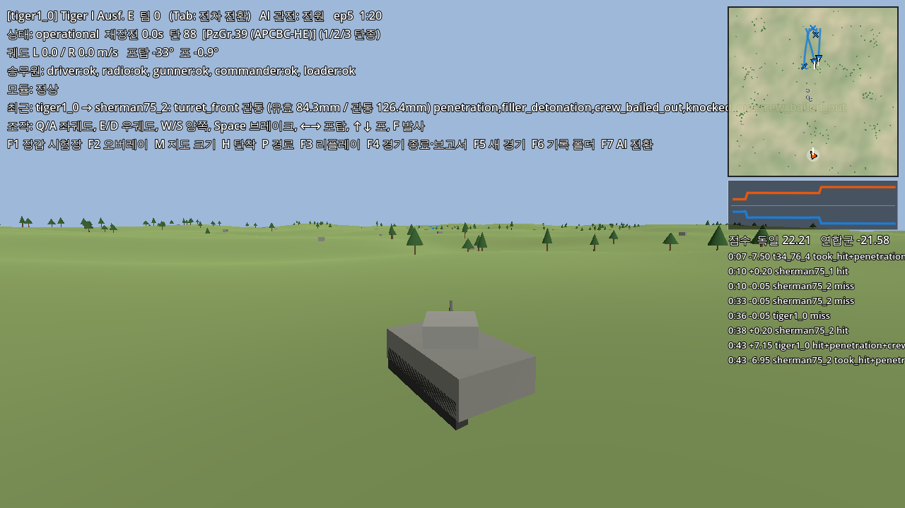
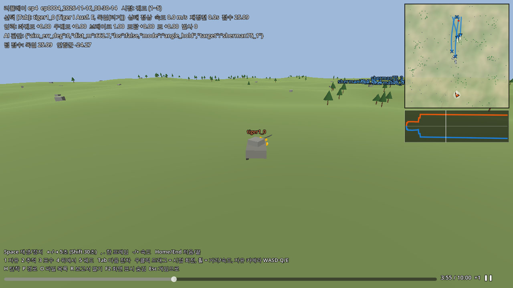
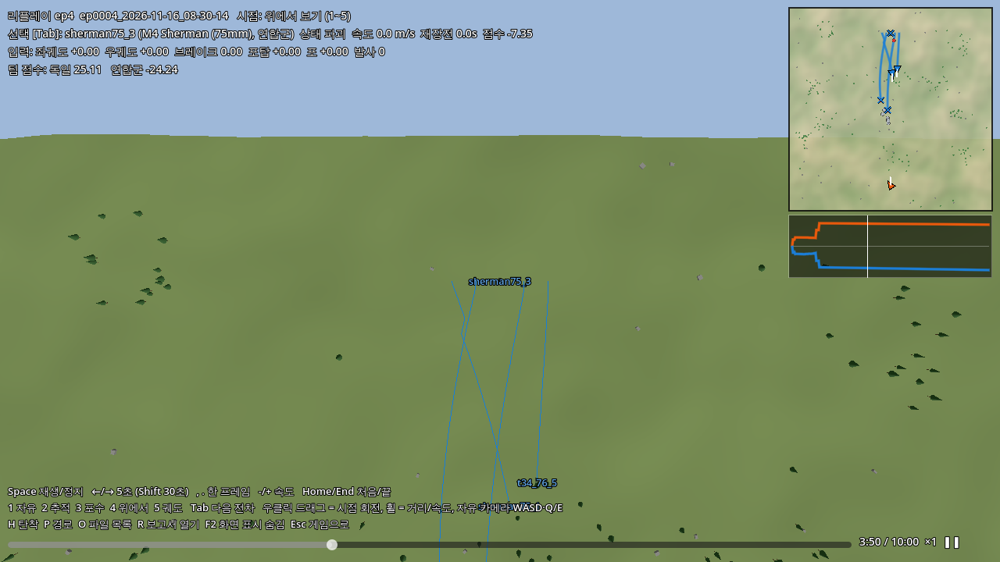
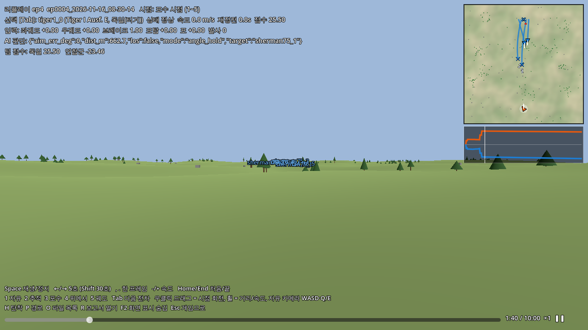

# recording/ — 경기 기록, 점수, 보고서, 리플레이

보고서용 자료와 실제 플레이·관찰용 화면을 한 가지 기록에서 만든다.

유효 명중 행의 **타격 시뮬레이션**을 누르면 기록된 탄착 재생과 전체 피해 목록을 연다.
`report.html`에는 타격 위치·탄종·거리·피해 SVG 이미지가 내장되며, `impacts/`에 재생 HTML과 SVG도 저장된다.
타격 당시 형상을 함께 저장하므로 이후 전차 제원을 변경해도 새 기록의 타격 이미지는 당시 형상을 사용한다.

```
게임/학습 ──▶ MatchRecorder ──▶ events.jsonl ──┬─▶ ReportBuilder ──▶ report.html + shots/paths/score.csv
                  │                            └─▶ 리플레이 뷰어(F3) : 자유·추적·포수·위·궤도 시점
                  └─▶ 관찰 오버레이(게임 중): 미니맵 동선, 탄착, 점수 그래프, 점수 사건
```

| 파일 | 역할 |
|---|---|
| `match_recorder.gd` | `MatchRecorder`: 에피소드 기록기. 프레임(10 Hz)·사격·점수·전투불능·AI 판단을 JSONL 로 저장, 종료 처리, `episodes.csv` 누적 |
| `reward_model.gd` | `RewardModel`: 점수(보상) 규칙. 관찰용 점수와 학습 보상이 같은 함수. 가중치는 기록 머리에 저장 |
| `replay_data.gd` | `ReplayData`: 기록 읽기 + 임의 시각 자세 보간(뷰어·보고서 공용) |
| `report_builder.gd` | `ReportBuilder`: 보고서 HTML(그림 포함 한 파일)과 CSV 생성 |
| `replay_viewer.tscn/.gd` | 리플레이 뷰어 |
| `scripted_ai.gd` | `ScriptedAI`: 기준선 규칙 AI(티거 비스듬한 대면 유지, 연합군 측면 접근). `TankPerception`(보이고 들리는 것)만 입력, 조작 6 + 시점 5 출력. 관전·시험용 |
| `ui/` | `MinimapView`(위에서 본 지도), `ScoreGraph`(점수 그래프), `WorldMarkers`(3D 탄착·궤적·경로·이름표) |
| `tools/make_report.gd` | 기록에서 보고서 다시 만들기(`-- --all` 이면 전체) |
| `tools/capture.gd` | 화면 캡처(문서용 그림) |
| `tests/run_record_tests.gd` | 보상·맵 재구성·기록·재구성 오차·보고서 검증 |

## 그래픽이 바뀌어도 똑같이 재구성되는 이유

- **상태를 그대로 저장**한다(입력을 저장해 다시 시뮬레이션하지 않음). 물리 엔진·전차 제원·피해 모델을 나중에 고쳐도 지난 경기는 기록된 그대로 다시 보인다.
- 맵은 시드가 아니라 **지형 높이 격자(10 m 간격)와 장애물 정확한 치수**(나무 높이·줄기·수관 반경, 바위 크기·회전)를 저장한다 → 생성 알고리즘이 바뀌어도 같은 맵.
- 전차는 위치 + 자세(쿼터니언) + 포탑 회전 + 포 고저각 + 상태 코드 + 그 순간 입력 6개. 제원 치수(차체·포탑 크기)도 머리에 저장.
- 렌더링은 기록을 읽어 **외형만 움직이는 꼭두각시**(`Tank.apply_replay_pose`)로 그린다. 모델을 고급 그래픽으로 바꿔도 이 함수만 맞추면 된다.
- 자동 테스트에서 재구성 자세 오차 최대 0.7 mm(기록 반올림) 확인.

## events.jsonl 형식 (tankgame-replay v1)

한 줄 = JSON 하나, `type` 으로 구분. 새 항목은 뒤에만 추가하고 `version` 을 올린다.

| type | 내용 |
|---|---|
| `header` | `episode`, `physics_hz`(30), `sample_every`(3 → 10 Hz), `frame_fields`, `action_labels`, `reward_weights`, `map`(heights·obstacles·seed·size), `tanks`(id·이름·제원 id·팀·치수·rng_seed·초기 상태) |
| `frame` | `tick`, `t`(초), `s` = 전차별 배열(`frame_fields` 순서; 끝의 `view_mode, view_yaw, view_pitch, view_fov` = 그 전차의 시점, 버전 2), `score` = [독일, 연합군] 누적 점수, `r` = 전차별 누적 점수 |
| `shot` | `shooter`, `target`(id, −1 = 없음), `r` = 판정 전체(발사점 `from`, 방향 `dir`, 탄착점 `hit_pos`, 구역, 입사각, 유효장갑, 관통력 굴림, 관통 확률, 피해 목록, 사건) |
| `reward` | `tank`, `team`, `value`, `reason`(예: `hit+penetration+knockout`, `took_penetration`, `miss`, `win`) |
| `knockout` | `tank`, `cause`, `state`(전체 상태) |
| `decision` | `tank`, `obs`(관측 벡터 `TankPerception`, `--log-obs` 주기마다·그 외 빈 배열), `action`(AI 11 / 사람 6), `info`(`controller` human/scripted_ai, 판단 근거, `perception` = 보인 적·들린 소리 요약) |
| `end` | `reason`(elimination / time_limit / manual), `winner`(−1 무승부), `summary`, `final` |

`frame_fields`: x, y, z, qx, qy, qz, qw, turret_yaw, gun_pitch, track_l, track_r, status(0 정상 / 1 손상 / 2 전투불능 / 3 파괴), ammo_index, reload, a_left, a_right, a_brake, a_traverse, a_elev, a_fire

## 점수(보상) 기본값

| 항목 | 값 | | 항목 | 값 |
|---|---|---|---|---|
| 명중 | +0.2 | | 전투불능(격파) | +5 |
| 관통 | +1.0 | | 빗나감 | −0.05 |
| 승무원 부상 / 전사 | +0.25 / +0.5 | | 피격 전차 | 공격자 피해 점수만큼 감점 |
| 모듈 손상 / 파괴 | +0.1 / +0.3 | | 생존 1초당 | −0.002 |
| 아군 사격 | 위 점수 × −1 | | 승리 / 패배(팀 전원) | +10 / −10 |

바꾸려면 `MatchRecorder.start(map, tanks, meta, RewardModel.new({"knockout": 8.0}))`.

## 보고서(report.html) 구성

1. 전차별 요약(사격·명중·관통·격파·이동거리·점수)
2. 맵상 동선과 타격 위치(지형 음영 + 경로 + 사격선 + 탄착, 마우스 올리면 판정)
3. 팀별 체류 히트맵
4. 점수(목표값) 그래프: 팀 누적, 전차별 누적, 전투불능 시각
5. 에피소드별 점수 곡선(`episodes.csv` 누적, 학습 진행 확인)
6. 피탄 분석: 표적·구역별 관통률, 입사각 분포(비스듬한 대면 효과)
7. 타격 기록 표(모든 사격)

브라우저에서 열어 인쇄 → PDF 저장 가능. CSV 는 엑셀에서 바로 열린다.

## 학습 AI 를 붙일 때

```gdscript
var a: Array = policy.act(obs)                       # 액션 6개
tank.control = TankControlInput.from_array(a)
recorder.log_decision(tank, obs, a, {"value": v, "note": "..."})   # 판단 기록(선택)
# 보상: recorder.reward_added 시그널 또는 recorder.tank_scores 의 변화량
```

헤드리스 일괄 실행: `godot --headless --fixed-fps 30 --path . -- --episodes=100 [--seed=1] [--time-limit=600]`
(10분 경기 1판 ≈ 20초)

## 화면

| 게임 중 관찰 오버레이 | 리플레이: 궤도 시점 |
|---|---|
|  |  |
| 리플레이: 위에서 보기 | 리플레이: 포수 시점 |
|  |  |
