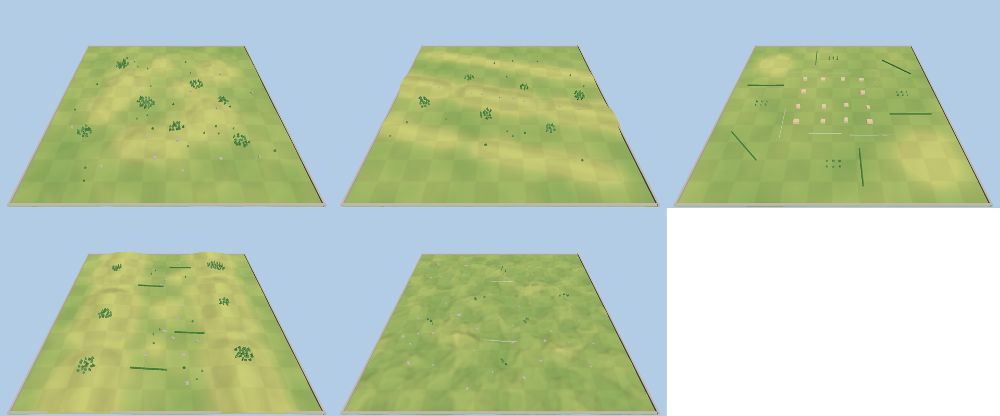

# 최종 학습: 티거 1 vs 연합군 6 · 맵 5종 · 엄폐

1대1 자기 대전(V5, `V5run 1`)으로 사격은 충분히 익혔지만, 상대가 하나뿐이라 엄폐 없이 정지한 채
장거리에서 먼저 맞히는 양상으로 굳었다. 최종 학습은 **여러 적을 동시에 상대**하게 해서 지형·장애물을
융통성 있게 쓰는 전술(헐다운, 노출 최소화, 은폐 후 사격, 측면 기동)이 이득이 되도록 만든다.

## 무엇이 바뀌나

| 항목 | V5 (1대1) | 최종 1대6 |
|---|---|---|
| 편성 | 같은/다른 전차 1대1 | 티거 I 1대 vs 셔먼 3 + T-34 3 |
| 맵 | 평지(+일부 장애물) | 굴곡·장애물 고정 맵 5종 (600×600m) |
| 스폰 | 정면 대치, 거리만 무작위 | 진입 방향·거리(260~420m)·옆 위치·흩어짐·차체 방향 모두 매 판 무작위 |
| 제한 시간 | 90~180초 | 240초 |
| 모델 | 세 전차 공통 1개 | 전차 종류별 3개(티거·셔먼·T-34). 같은 종류 전차들은 한 모델 |
| 보상 | 승패 + 사격 결과 + 접근 보조 | 같은 사격·승패 보상 + **엄폐 보상** + 생존 승리 보너스, 접근 보조는 절반 |

## 맵 5종



1. **구릉과 숲** `rolling_woods` — 완만한 언덕 8개, 숲 덩어리 7곳, 외딴 나무·바위. 언덕 뒤 헐다운과 숲 은폐.
2. **중앙 능선** `ridgeline` — 통로 두 곳이 있는 높은 능선과 양쪽 낮은 능선. 능선 위 바위가 헐다운 자리, 뒷사면 숲.
3. **마을** `village` — 집 십여 채와 돌담(1.4m)·생울타리, 과수원. 거의 평지라 근거리 엄폐·매복.
4. **계곡** `valley` — 양쪽 높은 능선(능선 위 숲)과 계곡 바닥의 바위·생울타리. 고지 점령 대 계곡 돌파.
5. **바위 지대** `boulder_field` — 울퉁불퉁한 지면과 큰 바위 수십 개, 나무 무리. 짧은 시선과 잦은 엄폐 교체.

맵은 지형·장애물이 고정이라(맵 시드 고정) Godot 이 매 판 맵을 다시 만들지 않는다. 덜 경험한 맵부터 고르므로
다섯 맵을 고르게 학습한다. 정의는 `training/python/tankrl/final_curriculum.py`의 `build_map()` 한 곳에 있다.
새 맵 기능: `HillMap.custom_ridges`·`mounds`(지정 지형), 시나리오 장애물 `house`·`hedge`·`wall`.

## 엄폐 보상 (Godot `training_reward.gd`, `config.reward.cover`)

0.5초마다 살아 있는 적 각각의 눈 위치에서 학습 전차가 실제로 보이는지(지형·장애물·수풀 투과율 포함) 검사한다.
정답 정보는 보상 계산에만 쓰고 정책 관측에는 넣지 않는다.

| 항목 | 값 | 뜻 |
|---|---:|---|
| 차체 노출 감점 | 초당 −0.1 × 차체를 보는 적 수(최대 3) | 여러 적에게 동시에 드러나는 자리를 피하게 |
| 노출 감점 한도 | 경기당 −20 | |
| 가린 채 관측 보상 | 초당 +0.05 | 학습 전차가 적을 보고 있는데 차체는 어느 적에게도 안 보일 때(헐다운·수풀 은폐) |
| 관측 보상 한도 | 경기당 +8 | |
| 생존 승리 | +30 | 이긴 팀에서 끝까지 살아남은 전차 |
| 승리 / 패배 / 시간 초과 | +200 / −80 / −35 | V5 와 같음. 숨어만 있다가 시간 초과로 끝나면 손해 |

사격 보상(명중·관통·격파·모듈·승무원)과 피격 감점은 V5 balance v2 그대로다. 접근 보조 보상은
1대6에서 무작정 돌격을 부추기지 않도록 V5의 절반(한도 +3.5)이고, 비관통 3회 또는 30초 무성과 뒤에만 켜진다.

## 학습 방식

- 한 판의 학습 전차는 1대. 나머지 6대는 상대 풀(`FINAL-1/opponents/`)의 고정 스냅숏이 조종한다.
  같은 종류 = 자기 모델의 최신(70%)·과거(30%) 스냅숏, 아직 스냅숏이 없는 종류 = V5 공통 모델.
- 티거 → 셔먼 → T-34 순서로 `--rotate-steps`만큼씩 번갈아 학습하고 `--cycles`번 반복한다.
- 각 전차 모델의 첫 시작은 `V5run 1`의 최신 공통 모델(가중치·optimizer·누적 스텝 1,609,086)이다.
  원본 `V5run 1` 폴더는 읽기만 하고 바꾸지 않는다. 관측 605개·행동 11개는 V5와 같다.
- 대시보드 커리큘럼 표: 맵 × 전차별 최근 40판의 명중·관통·교전 완료 + **생존·가린 채 관측 비율·2대 이상 노출 비율**.
  `scenario_progress.csv`의 `exposed_s`·`hull_exposed_s`와 `reward_components`(cover_exposed, cover_overwatch)로 엄폐 변화를 볼 수 있다.

## 실행

먼저 이 브랜치의 게임을 내보낸 `build/TankGame_final.exe`가 필요하다(옛 `TankGame_battle.exe`는 새 맵·엄폐 보상을 모른다).

**대시보드**: `dashboard.bat` → **새 학습** → 학습 방식 **최종 1대6 · 맵 5종 · 전차별 모델** →
실행 이름 `FINAL-1`, 시작 모델 실행 `V5run 1`, 게임 실행 파일 `build\TankGame_final.exe` → 시작.
이어서 할 때는 `FINAL-1`을 선택하고 **새 학습**(이어서 체크)으로 다시 시작한다.

**명령줄**: `training\python\train_final.bat` (같은 명령을 다시 실행하면 이어서 학습)

```powershell
training/python/.venv/Scripts/python.exe training/python/train.py --godot build/TankGame_final.exe --curriculum final --branch-from "V5run 1" --run FINAL-1 --rotate tiger1,sherman75,t34_76 --rotate-steps 2000000 --cycles 10 --n-envs 8 --device auto
```

7대 전투라 1대1보다 한 판이 무겁다(클라우드 4코어 시험: 환경 4개 ≈ 초당 170 결정).
교대 스텝 200만 × 3전차 × 10회 = 6천만 결정이 기본값이다.

## 검증

- `python -m unittest tests.test_final_curriculum` — 맵 5종 고정·굴곡 존재, 편성(티거 1 + 셔먼 3 + T-34 3), 스폰 무작위, 상태 저장/복원.
- 실제 시뮬레이터: `V5run 1` 가중치로 티거·T-34 모델을 만들어 1대6 경기 8판(4개 맵)이 정상 종료,
  엄폐 감점·관측 보상·생존 승리 보너스가 보상 기록에 나타나는 것을 확인했다. 아주 짧은 시험이라 학습 효과는 아직 판단할 수 없다.
- 맵 미리보기: `godot --path . -s res://training/tools/final_map_preview.gd -- --maps=maps.json --out=<폴더>`
  (`maps.json`은 `python -c "from tankrl.final_curriculum import dump_maps; dump_maps('maps.json')"`).
