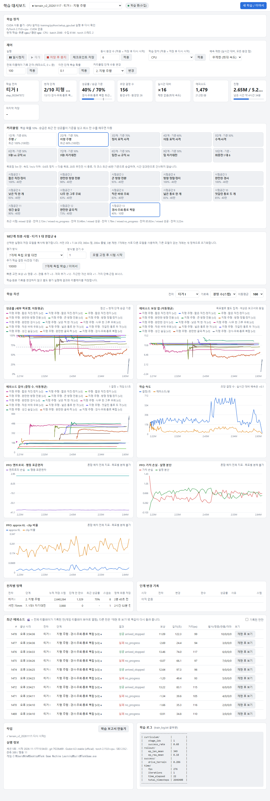

# 학습 처리량과 그래프 수정 (2026-11-17)

`terrain_v2_20261117`의 학습 모델·보상·관측·PPO 설정을 유지하고 통신 대기만 변경했다.
Godot가 소켓을 반복 조회하면서 짧게 자는 대신, 필요한 바이트를 소켓에서 직접 기다리게 했다.
일시정지와 PPO 갱신 때 CPU를 헛돌리지 않고, 다음 행동이 오면 타이머 대기 없이 진행한다.

현재 PC에서 같은 고정 지형 코스와 저장 정책으로 측정했다.

|동시 환경|초당 결정 수|
|---|---:|
|2|124.5|
|4|196.2|
|6|272.0|
|8|261.9|

6개를 유지했다. CPU 사용률을 높이기 위해 환경을 더 늘리는 것이 항상 빠르지는 않았다.
별도 6환경 A/B 반복에서 기존 통신은 199.9·151.2, 개선 통신은 276.6·259.9 결정/초였다.
단기 측정 평균은 약 1.5배이며, 실제 장기 속도는 코스·초기화·저장·PPO 갱신·다른 앱 부하에 따라 달라진다.
네 측정의 마지막 관측 배열 SHA-256이 동일해, 통신 변경이 시뮬레이션 결과를 바꾸지 않은 것을 확인했다.

학습은 2,640,264스텝에서 안전 저장 후 재개했고 총 목표 5,218,242스텝을 유지했다.
동시 환경 6개, PyTorch 스레드 2개, 환경당 1024스텝, 배치 2048, epoch 8 설정은 유지했다.

PPO CSV는 처음 학습 지표 열이 추가될 때 파일 전체를 다시 쓴다.
기존 대시보드는 이를 단순 추가로 처리해 오래된 헤더를 계속 사용했고, 학습 곡선이 첫 행에서 멈췄다.
이제 첫 헤더 변경을 감지하면 해당 CSV를 다시 읽는다. BOM과 미완성 줄도 처리한다.
지형주행에 데이터가 없는 독립 개체·사격 그래프는 숨기고, 성공률·보상·길이·PPO 곡선을 표시한다.
실제 브라우저에서 곡선 데이터와 렌더링을 확인했다.

